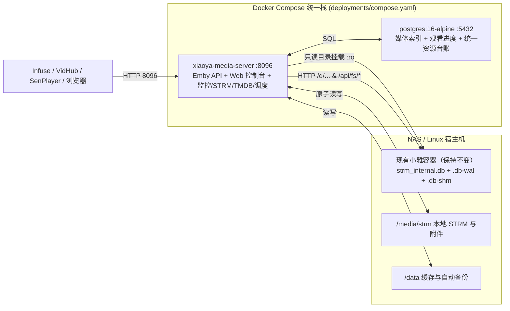

# Xiaoya Media Server V1.0 部署与运维指南

本文档对应《Xiaoya Media Server 完整技术方案 V1.0》第 11 章，提供单栈统一部署、小雅 SQLite 只读 WAL 安全挂载、首次初始化、备份恢复与版本升级的完整操作说明。

---

## 1. 部署拓扑概览



---

## 2. 关键前提：小雅 SQLite 只读挂载规范

1. **零侵入不改造小雅容器**：保持现有小雅容器原样运行，禁止修改小雅镜像、启动脚本或建库逻辑。
2. **必须挂载父目录而非单文件**：
   - SQLite 在 WAL 模式下会伴随生成 `strm_internal.db-wal` 和 `strm_internal.db-shm`。
   - 若仅挂载单个 `.db` 文件，容器内无法读取 `-wal` 中尚未 checkpoint 的最新节点，甚至可能因 inode 替换导致旧句柄失效。
   - 因此在 `deployments/compose.yaml` 中必须将宿主机目录挂载为 `/xiaoya-db:ro`：
     ```yaml
     volumes:
       - ${XIAOYA_DB_DIR}:/xiaoya-db:ro
     ```
3. **连接层双重只读锁定**：
   - 程序内部通过 `file:<path>?mode=ro&_pragma=query_only(1)&_pragma=busy_timeout(5000)` 打开连接，并在启动与每次扫描前执行 `VerifyReadOnly` 校验，确保绝不向小雅库写入任何字节或创建索引。

---

## 3. 快速部署步骤（Docker Compose）

### 3.1 准备环境变量

```bash
cd deployments
cp .env.example .env
```

编辑 `.env`，重点确认以下必填项：

| 变量名 | 说明 | 示例 |
|---|---|---|
| `POSTGRES_PASSWORD` | PostgreSQL 强密码 | `StrongPass_2026!` |
| `ADMIN_PASSWORD` | 初始 `admin` 管理员密码（**不少于 12 位**） | `AdminPass_2026!` |
| `XIAOYA_DB_DIR` | 宿主机上 `strm_internal.db` 所在**父目录** | `/vol1/1000/xiaoya/data` |
| `ALIST_BASE_URL` | 客户端与服务端可访问的小雅地址 | `http://192.168.1.10:5678` |
| `STRM_TARGET_BASE_URL` | 写入 `.strm` 文件的目标地址（默认同 `ALIST_BASE_URL`） | `http://192.168.1.10:5678` |
| `TMDB_API_KEY` | TMDB v3 API Key（无本地 NFO 时自动刮削） | `your_tmdb_v3_key` |
| `MONITOR_ROOTS` | 初始精确监控根目录（逗号分隔） | `/每日更新/电视剧/国产剧（115）,/每日更新/电视剧/国产剧` |

### 3.2 启动服务栈

```bash
docker compose -f deployments/compose.yaml --env-file deployments/.env up -d --build
```

检查健康状态：

```bash
curl -fsS http://127.0.0.1:8096/api/system/health
# 期望输出：{"service":"xiaoya-media-server","status":"ok"}
```

### 3.3 首次进入后台完成媒体库关联

1. 浏览器访问 `http://<NAS_IP>:8096`，使用用户名 `admin` 与 `.env` 中的 `ADMIN_PASSWORD` 登录。
2. 点击右上角用户图标 → **后台管理**。
3. 在 **媒体库** 面板新建电视剧媒体库（例如名称 `国产剧`，目录选择 `/media/strm/每日更新/电视剧` 或 `/media/strm`）。
4. 切换到 **资源与监控** 面板：
   - 确认“Xiaoya SQLite 只读数据源”状态为 `🟢 已连接 (RO)`；
   - 点击 **全量同步全部** 完成首次基线快照与 `.strm` / 附件落地，系统会自动触发对应目录的局部媒体库扫描；
   - 后续每 `10m`（可配）由后台调度器自动执行增量同步，每日自动执行全量树差异校验。
5. 如需在指定监控目录之外按需追剧或入库单部电影，切换到 **AList 入库** 面板浏览或搜索小雅目录，点击 **整剧入库+追更** 或 **单文件入库** 即可。

---

## 4. 飞牛 OS (fnOS) NAS 专属部署指南

飞牛 OS 内置 Docker 与 Compose 应用管理器，无需在 NAS 上安装 Go 开发环境即可一键拉取镜像部署：

### 4.1 在飞牛 OS 中创建项目
1. 打开飞牛 OS 网页控制台，进入 **Docker** -> **Compose**（项目）。
2. 点击 **创建项目**，输入项目名称（如 `xiaoya-media-server`）。
3. 项目路径选择你希望存放数据的存储卷（例如 `/vol1/1000/docker/xiaoya-media-server`）。

### 4.2 配置 Compose 与环境变量
直接粘贴项目 [deployments/compose.yaml](file:///Users/oneal/data/dev/projects/nas/xiaoya-media-server/deployments/compose.yaml) 内容。

根据飞牛 OS 上的小雅容器路径填写环境变量（或在同级创建 `.env`）：
- `XIAOYA_DB_DIR`: 飞牛上小雅容器挂载的宿主机配置目录（必须包含 `strm_internal.db` 的父目录，例如 `/vol1/1000/docker/xiaoya/data`）。
- `MEDIA_DIR`: 飞牛上存放 STRM 文件的存储空间（例如 `/vol1/1000/media`）。
- `APP_DATA_DIR`: 持久化缓存与自动备份目录（例如 `/vol1/1000/docker/xiaoya-media-server/appdata`）。
- `POSTGRES_DATA_DIR`: 数据库存储目录（例如 `/vol1/1000/docker/xiaoya-media-server/pgdata`）。
- `POSTGRES_PASSWORD`: 设置 PostgreSQL 数据库强密码。
- `ADMIN_PASSWORD`: 初始管理员登录密码（至少 12 位）。
- `ALIST_BASE_URL`: 小雅 AList 访问地址（例如 `http://192.168.x.x:5678` 或 `http://xiaoya:5678` 如果在同一 Docker 网络）。

### 4.3 启动与访问
点击 **立即构建/启动**，飞牛 OS 将自动从 `ghcr.io/clowrain/xiaoya-media-server:latest` 拉取对应平台（AMD64 / ARM64）的多架构镜像并运行。
服务启动后通过 `http://<飞牛NAS_IP>:8096` 即可进入 Web 控制台或在 Infuse / VidHub 客户端中添加 Emby 连接。

---

## 5. 本地源码编译与运行

```bash
# 1. 纯静态编译（无 CGo 依赖）
CGO_ENABLED=0 go build -mod=vendor -o bin/xiaoya-media-server ./cmd/server

# 2. 仅初始化/迁移 PostgreSQL 表结构并退出（可选）
./bin/xiaoya-media-server -config configs/config.example.yaml -prepare-schema

# 3. 启动统一服务
./bin/xiaoya-media-server -config configs/config.example.yaml
```

---

## 5. 备份、恢复与升级说明

1. **自动备份**：
   - 服务内置每 24 小时执行一次 `pg_dump`，备份文件保存在 `/data/backups/`（对应宿主机 `${APP_DATA_DIR}/backups/`），自动保留最近 14 份快照。
2. **手动备份与恢复**：
   ```bash
   # 手动导出
   docker exec xiaoya-media-postgres pg_dump -U emby emby > backup_$(date +%F).sql

   # 恢复到新库
   cat backup_2026-11-07.sql | docker exec -i xiaoya-media-postgres psql -U emby -d emby
   ```
3. **平滑升级**：
   - 所有数据库表结构迁移均具备幂等性（`CREATE TABLE IF NOT EXISTS` / `ADD COLUMN IF NOT EXISTS`）。
   - 拉取新版本源码或镜像后执行 `docker compose up -d --build`，服务启动时会自动完成增量迁移，保留全部用户、媒体库、`userdata` 观看记录、监控游标与人工入库台账。
