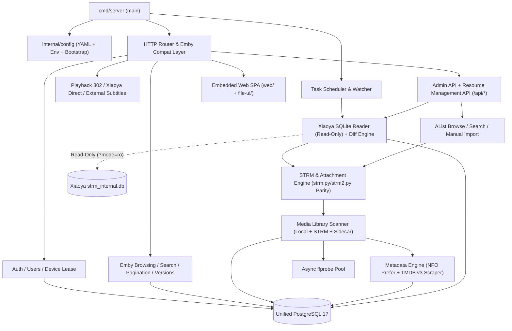

# `go-emby` 源码审计报告（M0 交付物）

**审计基线（C01）**：
- **源仓库**：https://github.com/sd87671067/go-emby
- **分支**：`main`
- **Commit SHA**：`ce9737d26697ff17c48e5004544b0509dd314d6e`
- **审计日期**：2026-11-07
- **代码规模**：Go 源码 38 个非测试文件 + 30 个测试文件（共 11,121 行），内嵌单文件 Web SPA（`web/index.html`）与 Vue 3 文件管理前端（`file-ui/`）

---

## 1. 核心审计结论（Executive Summary）

### 1.1 公开仓库源码与 GHCR 闭源镜像的边界差异（C02）
原仓库 `VALIDATION.md` 第 11 行明确记录：
> *“公共仓库仅更新部署配置与文档，未上传或更新应用源码。”*

逐文件审计证实，原仓库 `README.md` / `ENV_GUIDE.md` / `compose.yaml` 中描述的部分后期特性仅存在于作者私有构建镜像中，**不在当前公开 Go 源码内**：

| 能力项 | 公开 Go 源码真实状态 | 二次开发处置策略 |
|---|---|---|
| PostgreSQL 存储与索引架构 | **已完整具备**（20 张表、GIN `pg_trgm`、拼音首字母函数、触发器） | **直接复用并扩展**资源引擎表 |
| Emby 核心协议、登录、设备并发限制 | **已完整具备**（Token/API Key、180s 播放租约、`max_devices`） | **直接复用** |
| 分页游标、多版本合并、拼音检索 | **已完整具备**（Keyset 游标映射 `StartIndex`、`{tmdb-*}` 版本合并） | **直接复用** |
| 媒体流探测（`ffprobe`）与下一集预热 | **已完整具备**（异步队列、原子 JSON + `media_probe` 持久化） | **直接复用** |
| Xiaoya 5678 播放 302 直链解析 | **已具备**（`xiaoya.go` + `direct_strm.go` 5s 缓存与 SSRF 防护） | **保留并增强签名过期容错** |
| Web 海报墙、管理后台与文件管理器 | **已完整具备**（`web/index.html` + `file-ui/` Vue 3 SPA） | **复用并扩展**资源发现/入库/TMDB 管理页 |
| 远程授权锁（`internal/licensesdk`） | 启动强校验 `/run/license-machine-id` 并向 `https://tl.macacaaca.top` 续租，离线超 12h 全局返回 `HTTP 402` | **M1 移除远程授权中间件**，保障私有独立部署 |
| 容器启动参数 `--prepare-schema` | `compose.yaml` 传 `--prepare-schema` + `/run/bootstrap/postgres-password`，但源码实际只认 `SCHEMA_ONLY=1` 与 `DATABASE_URL` | **M1 统一 CLI 参数与配置加载** |
| TMDB API 联网刮削 | **完全缺失**（仅读取本地 NFO，及反代 NFO 中已有的 `image.tmdb.org` 演员头像） | **M2 自主实现** TMDB v3 客户端 + NFO `prefer` 引擎 |
| 外挂字幕与本地视频文件扫描 | **被显式拦截/忽略**（`main.go:329` 对 `/subtitles` 返回 `403`；`scanner.go:248` 仅扫 `.strm`） | **M2/M3 放开并实现**外挂字幕流接口与本地媒体索引 |
| `/Shows/NextUp` 接下来观看 | **被空桩覆盖**（`browsing.go:487` 提前返回空数组 `[]`） | **M3 修复**基于 `resume_activity` / `userdata` 的真实查询 |
|《折月亮》嵌套目录与集号解析 | **存在 2 处真实 Bug**（见 1.2 节） | **M2 定向修复并补回归测试** |
| Xiaoya SQLite 发现、STRM 生成、AList 入库 | **完全缺失**（仅靠外部预先生成 `.strm`） | **M4–M8 原生融合实现** |
| 源删除 `keep`（`MISSING` 保留）策略 | **冲突**（`snapshot.go:commitSnapshot` 一旦磁盘缺文件即 `DELETE` 记录与进度） | **M5/M7 改造**支持 `MISSING` 状态保留与人工确认清理 |

### 1.2 针对《折月亮》真实样本提前发现的 2 处原码缺陷
对照方案 3.1 节真实目录树 `/每日更新/电视剧/国产剧/折月亮 (2026)/{tmdb-270431}/Season 1/E01.strm`：
1. **剧名误识别为 `{tmdb-270431}`（`snapshot.go:133-145`）**：
   `seriesDirectory()` 匹配到 `Season 1` 后直接返回 `filepath.Dir(p)`，即 `.../折月亮 (2026)/{tmdb-270431}`，导致 `scanner.go:276` 将电视剧名称建档为 `"{tmdb-270431}"` 而非 `"折月亮 (2026)"`。
   - **修复方案**：向上回溯识别纯标签中间目录（`^\{tmdb(?:id)?-(\d+)\}$`），提取 `TMDB ID = 270431` 注入剧集元数据，同时继续向上取真实剧名目录 `折月亮 (2026)`（解析标题 `折月亮`、年份 `2026`）。
2. **纯 `E01` 集号无法识别（`scanner.go:25, 269`）**：
   原正则 `(?i)S(\d{1,3})E(\d{1,4})` 要求必须同时出现 `SxxExx`，面对 `Season 1/E01.strm` 时 `Episode` 解析为 `0`，导致分集排序与多版本合并失效。
   - **修复方案**：分级匹配 `S01E01` -> `EP?01` -> `第01集/话` -> 季目录内纯数字文件名 `01`，确保 `E01`–`E27` 准确解析为第 1 季第 1–27 集。

### 1.3 第三方依赖与许可核查（C03）
`go.mod` 依赖极其精简且全部兼容 `CGO_ENABLED=0` 静态编译：
- `github.com/lib/pq v1.10.9` — MIT License
- `golang.org/x/crypto v0.48.0` / `golang.org/x/sys v0.41.0` — BSD-3-Clause License
- `github.com/fsnotify/fsnotify v1.10.1` — BSD-3-Clause License
- `github.com/mozillazg/go-pinyin v0.21.0` — MIT License
- **新增计划依赖（M4 SQLite 只读访问）**：采用纯 Go 实现 `modernc.org/sqlite`（BSD-3-Clause），保持 `CGO_ENABLED=0` 跨平台构建 `linux/amd64` 与 `linux/arm64` 镜像。
- 原仓库未附带开源 `LICENSE` 文件，依据用户已确认的二次开发授权范围作为内部/自有服务基线使用。

---

## 2. 模块依赖图

---

## 3. 原项目模块清单与职责映射

| 领域 | 原文件 | 核心职责 | 迁移评估 |
|---|---|---|---|
| 启动与路由 | `main.go`, `memory.go`, `endpoint.go` | HTTP 服务、CORS、Emby 路由分发、备份、优雅退出 | 保留协议层，拆分巨型文件，移除 `licensesdk` |
| 数据库基础 | `database.go`, `postgres_schema.go`, `initials.go` | PostgreSQL 连接池、`?` 占位符绑定、`pg_trgm` 与拼音首字母索引 | 直接保留，新增迁移版本管理表 `schema_migrations` |
| 认证与权限 | `login_compat.go`, `user_identity.go`, `admin_extra.go` | 登录限流、JSON/Form 兼容、设备数租约（180s）、播放开关 | 直接保留 |
| 浏览与兼容 | `browsing.go`, `compat.go`, `pagination.go`, `versions.go` | 媒体列表/详情、游标分页、多版本合并、客户端兼容（Lenna/Infuse/SenPlayer/VidHub） | 保留并修复 `/Shows/NextUp` 与外挂字幕 |
| 扫描与快照 | `scanner.go`, `snapshot.go`, `watcher.go`, `library_queue.go`, `library_paths.go`, `scan_control.go` | 多目录媒体库扫描、增量快照、暂停/恢复、`fsnotify` 监听 | 增强剧集目录识别、本地视频支持及 `MISSING` `keep` 保护 |
| 媒体探测与图片 | `probe.go`, `media_settings.go`, `media_restore.go`, `thumbnails.go`, `image_upload.go` | `ffprobe` 提取、下一集预加载、纯 Go 缩略图缓存、自定义封面 | 直接保留 |
| 播放与网关 | `direct_strm.go`, `xiaoya.go`, `gateway.go`, `proxy_ports.go`, `proxy_debug.go`, `redirect_log.go` | Xiaoya `:5678` 直链解析、反代端口跳转、5s 缓存、请求诊断 | 保留，补充签名失效检测与刷新挂钩 |
| 管理与文件 | `activity.go`, `error_log.go`, `media_manage.go`, `files.go`, `files_web.go` | 环形活动日志、条目改名/删除、嵌入式文件管理器 | 保留，并与 `/api/resources` 等新管理接口整合 |

---

## 4. Emby API 与管理路由现状核查

原服务通过 `embyPath()` 统一剥离可选的 `/emby` 前缀，大小写不敏感匹配：

### 4.1 已实现的 Emby 兼容接口
- **系统与会话**：`GET /System/Ping`、`GET /System/Info/Public`、`GET /System/Info`、`GET /System/Endpoint`、`POST /Users/AuthenticateByName`、`POST /Sessions/Capabilities[/Full]`、`POST /Sessions/Logout`、`GET /Sessions`
- **用户与视图**：`GET /Users/Public`、`GET /Users/Me`、`GET /Users`、`GET /Users/{uid}`、`POST /Users/{uid}/Password`、`GET /Users/{uid}/Views`、`GET /Library/VirtualFolders`、`GET /Library/MediaFolders`、`POST /Library/Refresh`
- **媒体浏览与检索**：`GET [/Users/{uid}]/Items`、`GET [/Users/{uid}]/Items/Latest`、`GET [/Users/{uid}]/Items/Resume`、`GET [/Users/{uid}]/Items/{id}`、`GET /Items/Counts`、`GET /Items/{id}/Similar`、`GET /Shows/{id}/Seasons`、`GET /Shows/{id}/Episodes`、`GET /Persons`、`GET /Persons/{id}`、`GET /Genres`、`GET /Items/Filters[2]`、`GET /Movies/Recommendations`
- **图片与媒体探测**：`GET/POST /Items/{id}/Images/{type}`、`GET /Persons/{id}/Images/{type}`、`POST /Items/{id}/RefreshMediaInfo`、`POST /Items/{id}/Refresh`
- **播放与进度**：`GET/POST /Items/{id}/PlaybackInfo`、`GET/HEAD /Videos/{id}/stream*`、`GET/HEAD /Videos/{id}/original`、`POST /Sessions/Playing`、`POST /Sessions/Playing/Progress`、`POST /Sessions/Playing/Stopped`

### 4.2 待修复 / 待补齐的 Emby 接口
1. **`GET /Shows/NextUp`**：移除 `browsing.go:487` 空返回拦截，重写基于用户观看进度的下一集推导 SQL。
2. **`GET /Videos/{id}/{mediaSourceId}/Subtitles/{index}/Stream.{format}`**（及 `/Items/{id}/Subtitles/...`）：移除 `main.go:329` 对 `/subtitles` 的一刀切 `403` 拦截，扫描本地 `.srt/.ass/.ssa/.vtt/.sub` 外挂字幕并在 `MediaStreams` 中注入 `IsExternal: true, DeliveryMethod: "External", DeliveryUrl: ...`。

### 4.3 路由命名无冲突确认（方案第 10 节）
原项目自定义接口集中在 `/admin/*`、`/files/*`、`/api/files*`、`/health`。方案第 10 节规划的资源管理 API（`/api/monitor/roots`、`/api/resources`、`/api/batches`、`/api/sync/*`、`/api/alist/*`、`/api/tasks`、`/api/system/health`）**与现有路由完全无冲突**（仅需注意保留 `/health` 兼容 Docker 健康检查，同时提供 `/api/system/health`）。

---

## 5. 数据库融合方案（C04 / C05）

### 5.1 统一采用 PostgreSQL 17
原 `go-emby` 已经是纯 PostgreSQL 架构（含 `pg_trgm`、触发器、GIN 索引），与方案第 4、6 节建议的统一业务库 **PostgreSQL** 完全一致：
- **零数据破坏升级**：完整保留原 20 张表结构，现有 `go-emby` 用户、密码、Token、媒体库、观看进度（`userdata` / `resume_activity`）、媒体探测缓存可直接平滑沿用。
- **增量演进迁移机制**：引入 `migrations/` 与 `schema_migrations` 版本表，在原基线表之上扩展统一资源管理表：
  1. `monitor_roots`：监控根目录配置、启用状态、上次成功批次与游标。
  2. `sync_batches`：扫描批次记录（全量/增量/手动入库、起止时间、统计计数、状态、错误详情）。
  3. `sync_cursors`：目录扫描游标与最大节点水位线。
  4. `media_resources`：Xiaoya/AList 来源资源快照（`source_type`, `source_node_id`, `source_parent_id`, `source_path`, `name`, `is_dir`, `source_content`, `content_hash`, `path_hash`, `snapshot_hash`, `first_seen_at`, `last_seen_at`, `last_changed_at`, `status` [`ACTIVE` / `MISSING` / `ERROR`]）。
  5. `managed_resources`：管理策略绑定（`AUTO_MONITOR` / `MANUAL_FILE` / `MANUAL_SERIES`，输出 STRM 路径映射、关联 `items.id`）。
  6. `resource_change_history`：新增（`ADDED`）、内容更新（`MODIFIED`）、重命名/移动（`MOVED`）、缺失（`MISSING`）、恢复（`RESTORED`）审计流水。
  7. `media_attachments`：NFO、字幕、图片附件同步记录、内容 Hash、重试次数与错误原因。
  8. `tmdb_metadata_cache`：TMDB 电影/剧集/季/集刮削元数据与人工绑定映射（避免重扫丢失刮削结果，严格服从 NFO `prefer` 优先级）。
  9. `scheduled_tasks`：定时任务配置、运行锁、最近执行状态与下次触发时间。
- **`items` 表非破坏性扩展**：新增字段 `availability TEXT NOT NULL DEFAULT 'AVAILABLE'`（`AVAILABLE` / `MISSING`）与 `tmdb_id TEXT NOT NULL DEFAULT ''`；改造 `snapshot.go:commitSnapshot` 使处于 `managed_resources` `keep` 保护下的缺失资源仅标记 `MISSING` 而非硬删除，完整保留 `userdata` 播放历史。

---

## 6. 待确认事项（C01–C20）决议基线

基于本次源码审计与方案第 13 节默认建议，确立如下工程实施基线：

| 编号 | 决议内容 |
|---|---|
| C01–C03 | 固定 `sd87671067/go-emby` @ `ce9737d` 为二开基线；移除 `internal/licensesdk` 外联锁；第三方库均为 MIT/BSD，SQLite 采用纯 Go `modernc.org/sqlite`。 |
| C04–C05 | 统一使用 PostgreSQL 17，100% 兼容原 20 张表并新增资源/TMDB/调度迁移表。 |
| C06–C08 | 保持 Emby `4.8.0.80` 协议兼容，重点保障 VidHub / SenPlayer / Infuse；补齐 `/Shows/NextUp` 与外挂字幕接口；播放默认采用 `redirect`（含 Xiaoya 5678 实时直链解析）。 |
| C09–C10 | 播放时通过 `xiaoyaLink` 实时请求 AList `/d/...` 获取最新 302 直链（规避静态缓存过期）；自动监控走只读 SQLite，浏览/搜索/主动入库走 AList `/api/fs/*`，附件拉取走 `/d/*`。 |
| C11–C14 | 以 `scripts/ref/strm.py` 与 `strm2.py` 审计报告（`docs/STRM-RULES-AUDIT.md`）为准：扩展名取并集，`attachments: full`，保留相对目录，防 `.strm.strm` 与二次编码。 |
| C15–C20 | TMDB 默认 `zh-CN`（回退 `en-US`），API Key 通过环境变量/后台加密配置注入；复用并扩展嵌入式 `web/` 管理前端；资源移动保留路径历史映射，不自动误删旧文件。 |
